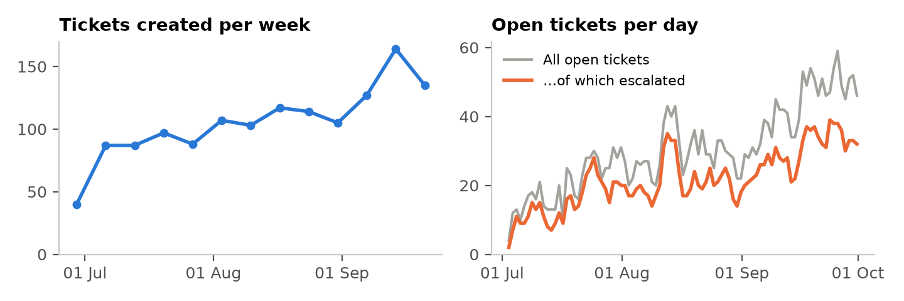
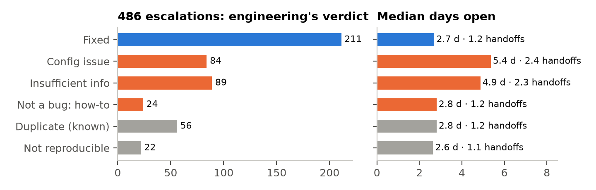
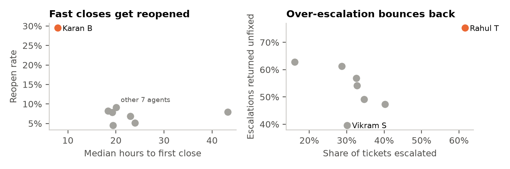
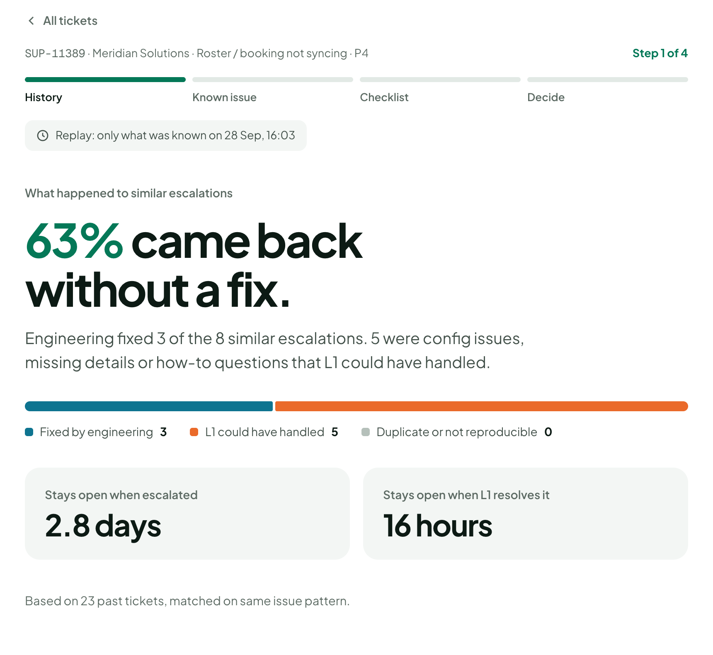
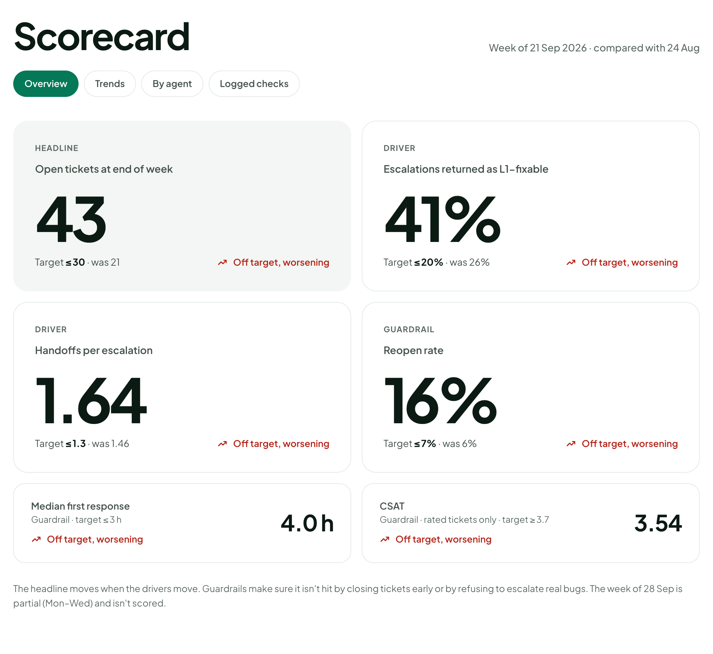

**The 2-minute version.** Open tickets rose because **more tickets are coming in** (+52% July→September) and **each ticket stays open longer**. Our team cannot hire, so the lever is removing wasted work. That waste is concentrated in one place: **escalations**. They are 34% of tickets but **71% of all the time tickets spend open**, and **57% of them come back from engineering without a fix**. 173 escalations bounced back as *config issue* or *insufficient info*. Those took 2.4 handoffs and about 5 days each, and got the lowest CSAT in the data (2.5/5). Both Meera and Sandeep are partly right, and the data says where: the problem is the **quality of the handoff**, and it varies far more by **agent** (40–75% bounce rate) than by issue type.

**What I built:** an *Escalation Check* for L1 agents. Before escalating, the agent sees what happened to similar escalations, gets a warning if it looks like a known issue or isn't engineering's, rules out config, and captures what engineering needs. It then produces the engineering note and the client update. A weekly scorecard tracks the effect. **Success measure:** open tickets at week end (43 → ≤30), driven by cutting L1-fixable bounce-backs from 41% to ≤20%, with reopen rate and first-response time as guardrails.

## 1 · Diagnosis

**Both inflow and time-in-system grew.** Tickets created rose from 390 (Jul) to 592 (Sep), +52%, across every tier and channel. The mean time a ticket stays open rose from 41 to 50 hours (+21%, understated because September tickets are still open). Open tickets on our own measure went from 29 (first half of August) to 50 (second half of September), +72%. The L1 team is visibly saturated: median first response slipped from 2.0 to 3.2 hours, and median time to close a non-escalated ticket from 8.6 to 12.9 hours. More of the same work will not fit into the same team.

**Escalations are where the open time sits.** 486 tickets (34%) went to engineering. Their median time open is 85 hours, against 13 hours for tickets L1 resolves alone, so they account for 71% of all ticket-hours. Of the 48 tickets still open at the data pull, 34 had been to engineering.

**Most escalations should not have reached engineering in that form.** Only 211 of 486 (43%) were fixed. 197 (41%) came back as things L1 could have handled: *config issue* (84), *insufficient info* (89) or *how-to* (24). The config and insufficient-info tickets are the expensive ones. They average 2.4 handoffs, sit open a median of about 5 days (vs 2.7 for fixed bugs) and score CSAT 2.55 against 3.41 for fixed tickets. They alone are 35% of all ticket-hours. Every extra handoff adds about 2 days (median 58h → 110h → 164h for 1/2/3 handoffs).

**What the team said, tested against the data:**

* **Sandeep is right:** 41% of escalations were L1-fixable. **Meera is partly right:** even real bugs take a median 2.7 days. The data has no engineering timestamps, so I can't split queue time from fix time. That is a gap to close in week 3.
* **"Some agents close tickets in a few hours":** that is mainly Karan B. His median first close is 7.9h vs 22.0h for everyone else, but **29% of his tickets get reopened vs 7%**. He accounts for 42% of all reopens on 15% of volume, and his CSAT is 3.13 vs 3.81. Fast closing is not the model to copy. Reopened tickets (10% of all tickets) take up 19% of ticket-hours and score CSAT 2.35.
* **The problem is agent practice, not issue type.** Bounce rate ranges from **40% (Vikram S) to 75% (Rahul T)** across agents, but only 50–66% across the main categories. Rahul escalates 62% of his tickets (team: 30%). He produced 61 of the 197 L1-fixable bounces and **18 of the 24 how-to escalations**. That points to a coaching and process gap, not a hiring gap.
* **Unfixed known bugs keep generating tickets.** Escalations marked *duplicate of known issue* grew from 8 (Jul) to 21 (Aug) to 27 (Sep). Three report-export issues (stuck monthly report, scheduled email not received, missing trips) account for 25 of the 56.
* **Not drivers:** channel (escalation rate 32–34% everywhere), priority (P1s close in a median of 17h) and client tier (Enterprise +59%, Mid-market +54%, SMB +23%; no single segment drives the growth).

**Data caveats.** The data starts on 2 July, so the July backlog is understated (tickets raised before then are missing), and leadership's "+60%" partly reflects that. CSAT has a 45% response rate. September durations are cut off at the data pull. Engineering outcomes are only the *final* verdict, with no timestamps per handoff.

## 2 · What "better" looks like, measured weekly

| | Measure (weekly) | Now (w/c 21 Sep) | Target, 6 weeks after rollout |
|---|---|---|---|
| **Headline** | Open tickets at end of week | 43 | ≤ 30 (back to the August level, despite volume growth) |
| **Driver** | Escalations returned as L1-fixable (config, missing info, how-to) | 41% | ≤ 20% |
| **Driver** | Handoffs per escalation | 1.64 | ≤ 1.3 |
| Guardrail | Reopen rate | 10% avg (16% that week) | ≤ 7% |
| Guardrail | Median first response · CSAT | 4.0h · 3.5 | ≤ 3h · ≥ 3.7 |
| Guardrail | Real bugs still escalated (count of *Fixed* outcomes) | about 16/week | does not fall |

**Why this set.** The headline is the number Ritika is judged on. On its own it can be gamed, by closing early or by refusing to escalate. The driver is the part L1 controls, and it moves the headline: if the 173 config and insufficient-info escalations had been handled like normal L1 tickets, **the average open backlog would have been about 30% lower**. Halving them is worth about 15% on its own, before any change to the known-issue duplicates or reopens. The guardrails catch the two obvious ways to game it. The *Weekly scorecard* view in the v0 computes all of these from the ticket data.

## 3 · The v0: Escalation Check for L1 agents

**Why the L1 agent.** The decision that creates the waste, *escalate now, in this form*, is made by the agent, ticket by ticket. A dashboard for the lead or for Ritika would show the problem but not change it. The agent is also where Sandeep's "do basic checks first" can actually happen.

**What it does.** It is a small web app: a Python API over the ticket CSV, with a hand-built interface in light and dark mode (`README.md` explains how to run it). The agent picks a ticket and goes through four short steps, one screen each:

1. **What happened to similar escalations.** It matches the ticket to past ones (same issue pattern, then similar wording, then category) and shows how many engineering fixed, how many came back as L1-fixable, and how long escalated tickets stayed open compared with L1-resolved ones. **Replay mode** stands at the moment a past ticket was raised and uses only what was known then, so there is no hindsight.
2. **Is it known, or not engineering's?** It warns when engineering marked the same issue as a *duplicate of a known issue* in the last 30 days, lists the same issue currently with engineering, and redirects categories that belong to ops, Product or compliance.
3. **Rule out config, collect what engineering needs.** A checklist per category, seeded from the outcomes that bounce most (e.g. roster cut-off changes apply from the next cycle; GPS: trip started, app version, location permission), plus the fields engineering needs.
4. **Decide.** Escalating is only marked "ready" when the checklist is complete. Escalating anyway requires a reason, which is logged. The tool generates a structured engineering note and a **client update message**, which answers Meera's "clients keep chasing us". Each decision is logged and feeds the **scorecard**, whose overview shows the headline, the two drivers and the guardrails against their targets, with trends and the per-agent view on their own tabs.

**Does it work?** Run against history using only data available at the time, the known-issue warning fires on 132 escalations and catches 32 of the 56 duplicates (57%). One in four warnings is a true duplicate, against a 12% base rate. That makes it a prompt to check, not a blocker. 28 escalations were in categories that belong to other teams. Honestly, **ticket text alone does not predict which escalation will bounce**. The signal is in agent practice. That is why the core of the tool is a checklist that agents must complete, not a prediction model. What the checklist will do to the bounce rate can only be shown in a live pilot (week 1).

**Deliberately left out of v0:** integration with the ticketing system, logins, an engineering-side view, an ML classifier (486 escalations, and the text carries little signal), and auto-drafting with an LLM.

## 4 · The next four weeks

| Week | What | Why this order |
|---|---|---|
| **1 · Validate and pilot** | 1 hour with Sandeep's leads to correct the checklists for Roster, GPS and Report export (78% of escalations). Pilot with **Rahul** (highest bounce rate) and **Vikram** (lowest, as a sense check). Engineering agrees that every "returned to L1" names the missing item, which then goes into the checklist. Scorecard enters Ritika's weekly review. | Cheapest test of the biggest lever. Gives a before/after on the driver metric within 2 weeks. |
| **2 · Roll out and close the reopen gap** | All 8 agents use the check. A confirm-before-close step for high-reopen categories (cab delay, GPS, roster). 1:1 coaching with Karan on reopens and Rahul on how-tos, kept private. Ask engineering for a **known-issues list** and a fix date for the three report-export bugs. | Reopens are 19% of open time. The known-issues list makes the duplicate warning exact instead of a pattern match. |
| **3 · Fix the engineering side** | Add timestamps per handoff, so Meera's claim can be measured. A first-response target for engineering on *ready* escalations. One-click "link to known issue + notify all affected clients". | Once escalations arrive complete, engineering turnaround becomes the next constraint, and both teams can see it. |
| **4 · Decide and reduce inflow** | Review the pilot vs the baseline. If the bounce rate halved, build the checklist into the ticketing system's escalation form as required fields and retire the separate tool. Take the fastest-growing inflow (address changes +200%, cab-delay complaints +148%) to Ops and Product as self-serve or prevention fixes. | Embed only what proved itself. Reducing inflow is the durable fix, but it needs product changes that a quarter-end target can't wait for. |

**What I would deliberately not do:** hire or ask for headcount (no budget, and the waste is not a capacity problem); push agents to close faster (that is Karan's 29% reopen rate); bulk-close old tickets to hit the number; build an ML triage model or a client chatbot before the checklist has been proven; or publish agent rankings. The per-agent view is for coaching, not blame.

**Assumptions.** Ticket text is a one-line summary only. Engineering's final verdict reflects what actually happened. Checklist content is my best inference from the outcomes and needs engineering's sign-off. "Week" means Monday to Sunday. Effect sizes are back-of-envelope estimates from historical ticket-hours, not forecasts.
